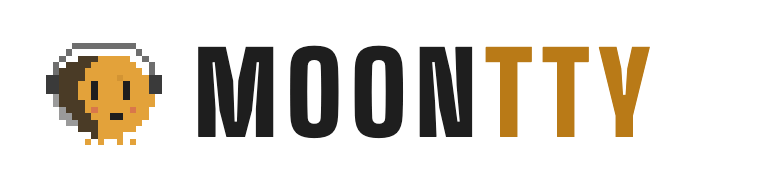
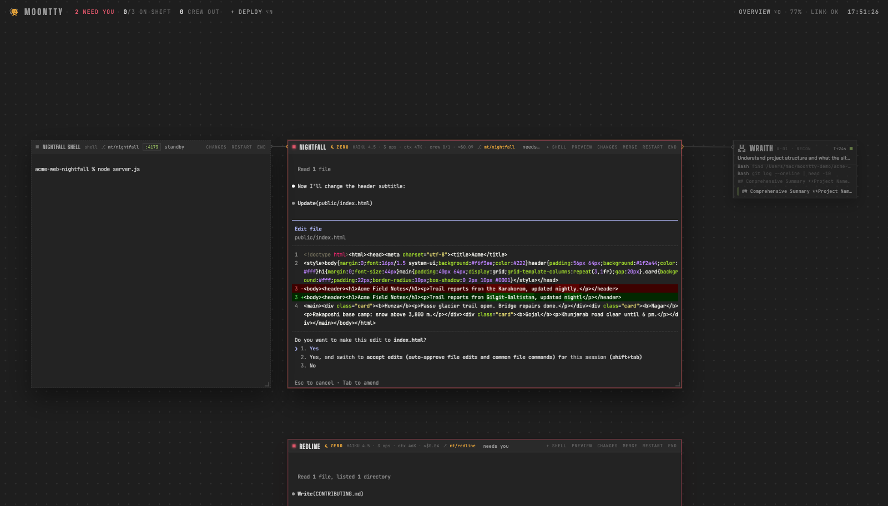
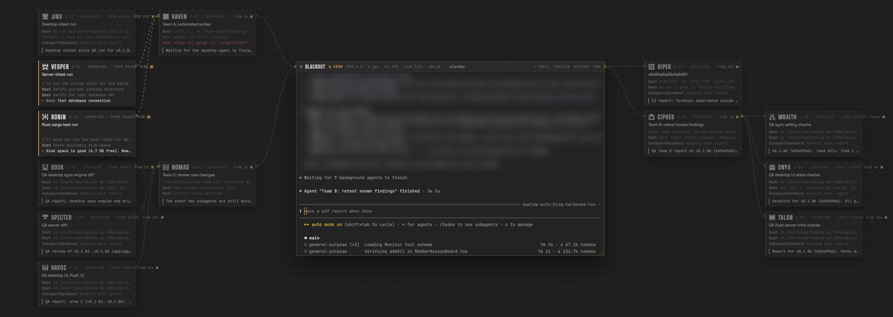
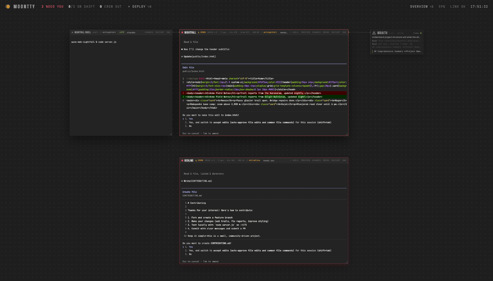
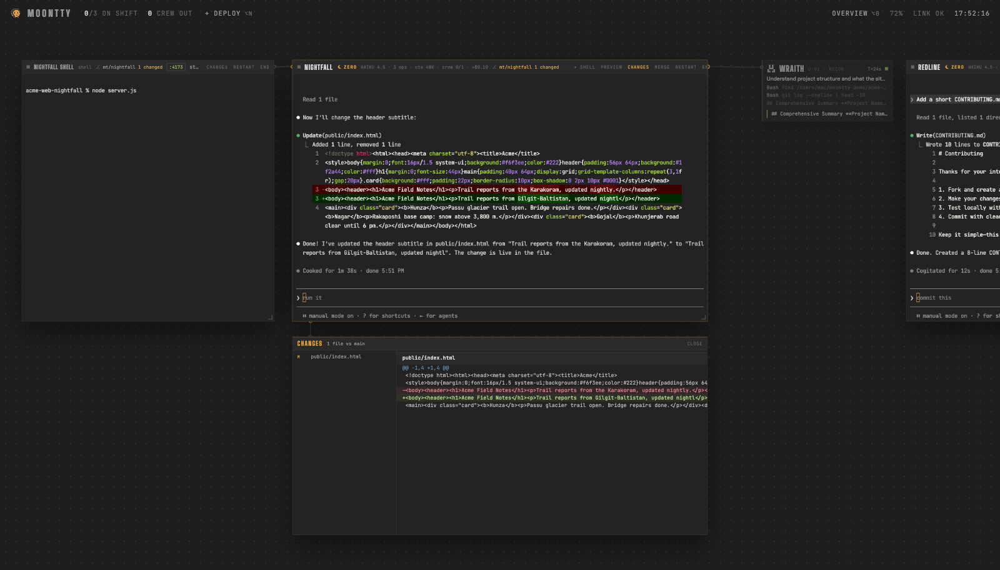
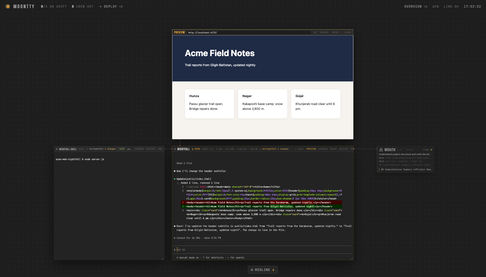
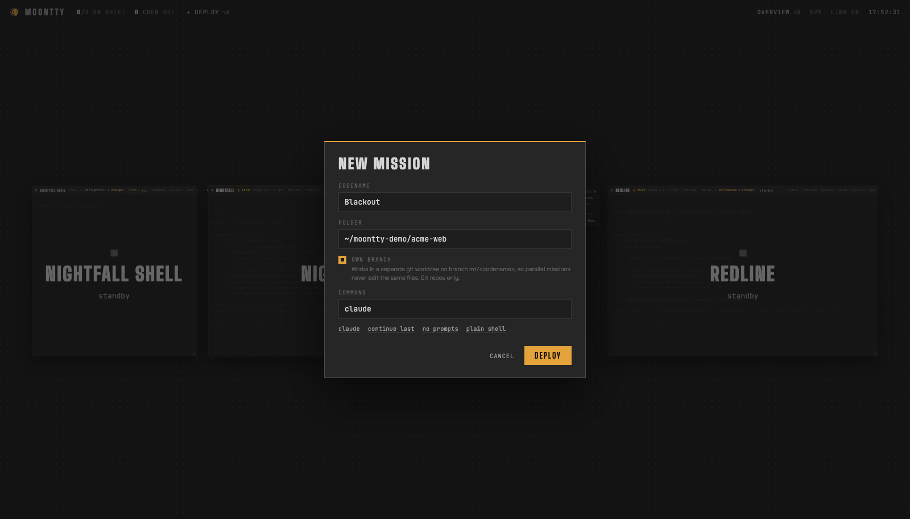

<p align="center">
  <picture>
    <source media="(prefers-color-scheme: dark)" srcset="brand/logo.png">
    
  </picture>
</p>

<p align="center"><b>Every Claude Code session and every subagent it sends out, live on one canvas.</b></p>

<p align="center">
  
</p>

Moontty keeps watch over every Claude Code agent you run at once. Each agent gets a real terminal floating on a pan-and-zoom canvas. The subagents it spawns hang off it on wires, with their orders, every tool call and their final report. You see who is working, who is done, and who is waiting on you, without clicking through tabs.

It runs your own shell in real PTYs. Nothing about Claude Code changes: you type into the same `claude` you already use.

## How Moontty is different

There are good tools for running agents in parallel. [Conductor](https://www.conductor.build), [Superset](https://github.com/superset-sh/superset), [cmux](https://github.com/manaflow-ai/cmux) and [Claude Squad](https://github.com/smtg-ai/claude-squad) give each agent its own workspace and organize them mostly as lists: a sidebar, tabs or a terminal UI. Moontty takes a different shape:

1. **A map, not a list.** Missions are windows on a canvas you arrange yourself. Zoom out and every agent is still on screen as a big name plate with a status light. Off-screen missions leave a beacon on the edge pointing at them.
2. **It shows the crew.** When Claude sends out subagents, each one appears as a node wired to its mission, with a call sign, its role, its orders, a live log of tool calls and its report when it hands back.
3. **Status from Claude Code itself.** A Claude Code hook reports every prompt, tool call, permission request and stop. "Needs you" lights up the moment Claude asks, with what it wants ("wants to run: npm test"), and clears when you answer.
4. **Your terminal, unwrapped.** No chat UI on top of the agent. It is your login shell, your `claude`, your keybindings, in a GPU-rendered xterm.
5. **Small and local.** A 600 KB native Mac window around a local Node server. No account, no telemetry, no cloud. MIT licensed.

### Agent teams, laid out as a tree

When the lead agent sends out a team and each teammate sends out its own subagents, Moontty arranges them around the mission: the team split left and right, each member's subagents lined up beside it and wired to it, labeled with who sent them.

<p align="center">
  
</p>

## What you get

| | |
|---|---|
| **Exact status** | working, needs you, done, straight from Claude Code hooks, with the pending request on the title bar. Desktop notification, dock badge and a soft chime when a mission finishes. |
| **Crew view** | subagents as wired nodes around the mission, nested by who sent whom: call sign, role, orders, per-tool timeline, report. Click a node to expand its full log. |
| **Own branch per mission** | tick "Own branch" and the mission works in its own git worktree on `mt/<codename>`, with your `.env` files copied over. Parallel agents never edit the same files. |
| **Changes panel** | a diff of everything the mission changed, against the point it branched from, including new files. |
| **Merge and pull requests** | merge the branch back with one click (refuses with uncommitted work, undoes itself on conflicts), or push and open a PR. The PR number, state, checks and review show on the title bar. |
| **Survives restarts** | every pane runs under `dtach`. Restart or update the server and your agents keep working; the window reconnects and restores the screen. |
| **Docked shell** | `+ shell` docks a plain terminal beside a mission for dev servers and git. |
| **Preview pane** | listening ports show on the title bar. Click one to open a browser pane above the mission. Agents can drive it themselves with `mt-preview`. |
| **Spend** | tokens and an estimated API-rate cost for each mission, lead plus crew. |
| **Resume** | the deploy dialog lists past conversations in the folder; pick one to resume it. |
| **Find** | `⌘F` searches the scrollback, `⌘`-click opens links. |

<p align="center">
  
  
</p>
<p align="center">
  
  
</p>

## Install

Requirements: macOS, Node 18 or newer, [Claude Code](https://code.claude.com). Recommended: `dtach` (agents survive restarts) and `gh` (pull requests).

```sh
brew install dtach gh          # optional, but you want dtach
git clone https://github.com/nawazxz/moontty.git
cd moontty
npm install
./deck setup                   # checks your tools and installs the Claude Code hook
./deck                         # starts the server and opens Moontty
```

To get the native app in `/Applications` (needs Xcode command line tools for `swiftc`):

```sh
zsh mac/build.sh
```

To get a `moontty` command on your PATH: `ln -s "$PWD/deck" /usr/local/bin/moontty`.

## Using it

Press `⌥N` (or **+ deploy**) to start a mission: give it a codename, a folder and a command (`claude` by default). Tick **Own branch** to give it a worktree.

| Key | Does |
|---|---|
| `⌥N` | new mission |
| `⌥1` to `⌥9` | fly to mission 1 to 9 |
| `⌥]` / `⌥[` | next / previous mission |
| `⌥0` or `⌥G` | overview: fit everything on screen |
| `⌥=` / `⌥-` | zoom |
| `⌘F` | find in the current mission |
| `⌘`-click | open a link |
| pinch, `ctrl`-scroll | zoom the canvas |
| drag empty canvas, two-finger scroll | pan |

In Moontty.app, quitting (⌘Q or closing the window) stops everything, with a confirm if agents are still working. **Quit, keep agents running** (⌥⌘Q) only closes the window; they reattach next time.

```sh
moontty            # start (or reattach) and open the window
moontty stop       # stop the server; agents keep running and come back next start
moontty stop --all # stop the server, end every agent and start the next run clean
moontty log        # follow the server log
moontty setup      # re-run the checks and hook install
```

### Letting agents use the preview pane

Every pane has `mt-preview` on its PATH, so Claude can show you what it built:

```sh
mt-preview http://localhost:3000   # open it in the preview pane above this mission
mt-preview reload
mt-preview close
mt-preview shot http://localhost:3000 /tmp/page.png   # headless Chrome screenshot the agent can read
```

## How it works

- `server.js` owns the terminals (node-pty, each inside `dtach`) and serves the UI over a local WebSocket on `127.0.0.1:7681`. It refuses connections from other origins.
- `hook.sh` is a Claude Code hook for 11 events. Inside a Moontty pane it posts the hook's JSON to the server; anywhere else it exits immediately and prints nothing.
- `crew.js` tails the session transcripts Claude Code already writes under `~/.claude/projects/` to build the crew view, timelines and spend.
- `git.js` handles worktrees, diffs, merges and `gh` pull requests. Status polling uses `git --no-optional-locks` so it never fights the agent for `index.lock`.
- `mac/` is a small Swift/WebKit wrapper: native window, notifications, dock badge, file drop into a pane.
- State (sessions, saved screens, sockets) lives in `~/.agent-deck/`.

`./deck setup` adds this to `~/.claude/settings.json` (after backing it up) for each event:

```json
{ "hooks": [{ "type": "command", "command": "/path/to/moontty/hook.sh", "timeout": 3 }] }
```

## Limits

- macOS only for now. The web UI itself is plain HTML, so Linux support is mostly the `mac/` wrapper and paths.
- The crew view, exact status and spend are Claude Code specific. Other CLI agents run fine in a mission but get a screen-text guess for status.
- Output a program prints while the server is down is lost; the program itself keeps running.
- Spend is an estimate at public API rates. A Claude subscription is not billed per token.
- `mt-preview shot` and the app icon build need Google Chrome.

## Contributing

Issues and pull requests are welcome. Internal names still say `agent-deck` (the `deck` script, the `~/.agent-deck` state folder, the `AGENT_DECK_ID` variable). They stay for now because live sessions depend on them; a migration will follow.

Brand assets and rules are in [`brand/`](brand/BRAND.md).

## License

MIT, see [LICENSE](LICENSE). Made by [nawazxz](https://github.com/nawazxz).
