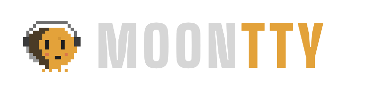

# Moontty brand

## Name

**Moontty**, said "moon tee tee why". Moon for the night shift your agents work while you sleep, `tty` for the terminal they live in. Written `Moontty` in prose, `MOONTTY` in the wordmark, `moontty` for the command and package.

In the wordmark, `MOON` is the text color and `TTY` is amber.

## Lines

- Tagline: **Keep watch over every agent.**
- Descriptor: Every Claude Code session and every subagent it sends out, live on one canvas.
- Sign-off: Your agents work the night shift. Moontty keeps watch.

The full identity (positioning, personality, voice, launch copy) is in `book.html`, built from `book.src.html`.

## Mascot: Nox

Nox is a pixel moon working the night shift.

- **Night side:** the dark crescent on its left is the moon's shadow. Nox is always caught mid-phase.
- **Cursor eyes:** its eyes are terminal block cursors. In animation, they blink like a cursor.
- **Headset:** Nox is on shift and listening for agents that need you.
- **Legs:** four stubby pixel legs, so it can walk across a canvas.

Rules:

- Nox is pixel art. Always scale by whole multiples and render with `image-rendering: pixelated`. Never smooth, blur or redraw it as vectors with curves.
- Keep the palette below. No outlines, gradients or drop shadows on Nox itself (a soft amber glow behind it is fine).
- The source of truth is the grid in `nox.py`. Edit the grid, run `render.sh`, and every asset updates.

## Color

From `public/style.css`. Low contrast on purpose: the app is for long nights.

| Token | Hex | Use |
|---|---|---|
| `--bg` | `#1e1e1e` | canvas |
| `--win` | `#232323` | windows, terminal background |
| `--chrome` | `#2a2a2a` | title bars |
| `--line` | `#363636` | borders |
| `--text` | `#d6d6d6` | main text |
| `--dim` | `#9a9a9a` | secondary text |
| `--mute` | `#666666` | labels, hints |
| `--amber` | `#e3a23a` | anything alive: active work, focus, the brand |
| `--red` | `#e0566a` | needs you, errors |
| `--green` | `#9cc463` | done, passing, ports |
| night side | `#4a3b26` | Nox's shadow |
| cheek | `#d9774a` | Nox's cheeks |

**Amber means alive.** Use it for things that are working or need focus, never as decoration.

## Type

| Role | Font |
|---|---|
| Wordmark, mission names, call signs | Big Shoulders Display, 800 to 900, uppercase, wide tracking |
| Interface | Chakra Petch |
| Terminals, numbers, labels | JetBrains Mono |

All three are on Google Fonts.

## Shape

- No rounded corners on interface elements. Frames are sharp.
- No pills, chips or rounded cards. Status is a square LED.
- Windows float on a dotted grid. Things that belong together are joined by wires.

## Words

The interface speaks night-shift ops. This table maps the terms to plain words for newcomers:

| In Moontty | Means |
|---|---|
| mission | one terminal window, usually running a Claude Code session |
| deploy | start a new mission |
| ZERO | the lead agent in a mission (the Claude you talk to) |
| crew | the subagents ZERO sends out |
| call sign | a crew member's name (GHOST, VIPER, WRAITH...) |
| on shift | missions that are working right now |
| needs you | waiting for your answer or permission |
| standby | idle, ready for the next prompt |
| docked shell | a plain terminal attached to a mission |

Voice for docs and posts: short, direct sentences. Say what it does, then stop. No hype words, no em dashes.

## Files

| File | What |
|---|---|
| `nox.py` | Nox's pixel grid; writes `nox.svg`, `nox-blink.svg` and one SVG per mood (`standby`, `working`, `needs-you`, `done`, `offline`) |
| `book.src.html` / `book.html` | the brand book; `book.html` has the Nox SVGs inlined |
| `render.html` | layouts for the PNG assets |
| `render.sh` | renders `logo.png`, `logo-light.png`, `social-preview.png`, `nox.png` with headless Chrome |
| `social-preview.png` | 1280x640, for the GitHub repo's social preview |
| `../mac/icon.html` | the app icon (Nox on a night tile), built by `mac/build.sh` |
